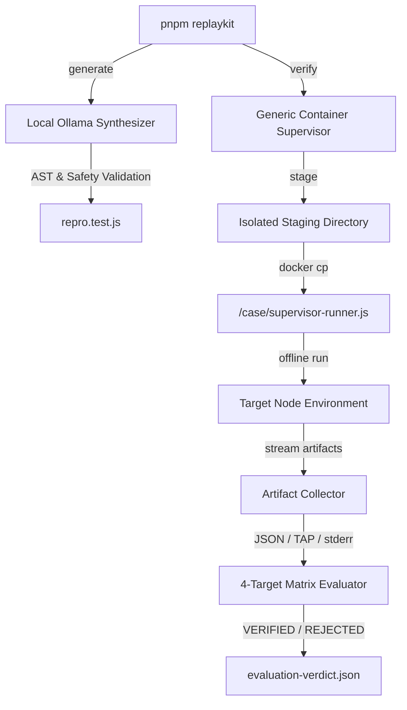

# Architecture

ReplayKit's current vertical slice captures and replays one synthetic payment retry incident, R1. TypeScript ESM packages share Zod contracts. PostgreSQL stores actual charges; a deterministic planner proposes an executable invariant test; a separate supervisor collects evidence for the judge.

## Execution path

```mermaid
flowchart LR
  C[CLI controller] -->|normalized JSON stdin| P[Isolated deterministic planner]
  P --> T[Generated node:test source]
  T --> R[Candidate container: network none]
  R <-->|bounded stdin/stdout protocol| B[Trusted broker supervisor]
  B -->|docker exec fixed HTTP client| A[Checkout app container]
  A --> D[(Fresh PostgreSQL container)]
  A -->|application incident logs| J[Independent evidence collector]
  D -->|supervisor psql query| J
  J --> E[Strict matrix evaluator]
  E --> O[Run JSON, Markdown and CSV]
```

The candidate has no network connection to the app or database. The app and PostgreSQL share a per-execution Docker internal network. The controller owns Docker access and implements the constrained bridge; it never imports generated candidate code on the host.

## Components

| Location                   | Responsibility                                                                                                                                       |
| -------------------------- | ---------------------------------------------------------------------------------------------------------------------------------------------------- |
| `apps/checkout-api`        | Payment API, PostgreSQL schema, synthetic provider ledger, domain exception, bounded incident logging and OpenTelemetry spans.                       |
| `apps/vscode-extension`    | VS Code / Cursor extension with Activity Bar view, honest progress reporting, test/report viewers, source navigation, and SecretStorage token store. |
| `packages/contracts`       | Versioned incident, request, plan, execution evidence and verdict schemas.                                                                           |
| `packages/telemetry`       | Sentry-shaped normalization, field/content redaction, frame normalization and telemetry-tier filtering.                                              |
| `packages/sentry`          | SSRF-safe Sentry client, DNS pinning, CIDR/metadata IP protection, frame normalization, and issue importer.                                          |
| `packages/planner`         | Pure deterministic function from visible incident evidence to a test or an explicit abstention; the CLI invokes it inside a dedicated planner image. |
| `packages/replay-engine`   | Cooperative checkpoint scheduler with ordered release, cancellation, timeouts and logical event records; currently unit-tested independently.        |
| `packages/judge`           | Candidate policy inspection, Docker runner, broker request validation, trusted observation collection and strict evaluation.                         |
| `packages/runtime`         | Asynchronous job lifecycle, crash/interruption recovery, atomic file state storage, and repository exclusive leasing.                                |
| `packages/mcp`             | Model Context Protocol (MCP) server over stdio for Cursor, Claude Desktop, and agent integration.                                                    |
| `packages/cli`             | Capture, incident run, stored-plan verification, smoke orchestration, background jobs, and report persistence.                                       |
| `scripts/build-sandbox.ts` | Allowlisted image contexts, four app policy snapshots, candidate SDK image and immutable-image manifest.                                             |
| `benchmark/private/R1`     | Independently stored buggy, reference, alternate and decoy policy source artifacts.                                                                  |

## Payment behavior and observation

The public API exposes `POST /payments`, `GET /charges?orderId=...`, and `GET /health`. Payment input contains only an order identifier, client idempotency key and positive integer amount. IDs are bounded to 128 characters and the amount to 100,000,000. This slice has no persisted orders, inventory or webhook model.

Each payment transaction locks the client key, rejects conflicting payload reuse, executes or reuses the synthetic provider charge, and records the attempt. Charges and attempts are committed before duplicate detection raises `DuplicatePaymentError`. The API returns a conflict response, while the independently queryable ledger retains the duplicate.

The default policy creates a fresh provider key on retry. The reference policy reuses the client key at the provider; the alternate retrieves the prior charge without another provider operation. The decoy preserves duplicate charges while suppressing the domain error. A build replaces only the compiled policy module in each app snapshot; application code contains no environment-selected variant switch.

`bootstrap.ts` initializes OpenTelemetry before dynamically loading the application. Explicit payment/provider spans have real SDK correlation IDs. Duplicate breadcrumbs come from persisted attempt rows, and the application frame comes from the observed error stack. Unknown frames do not receive the expected payment identity. Recent span snapshots are bounded in memory.

## Planning and judging

The planner function uses no filesystem, process, network or model APIs. The CLI invokes it through `planInSandbox`, which sends normalized JSON on stdin to a dedicated container and validates the returned plan. That image contains the public buggy application snapshot, planner implementation and contracts; it has no private variants, Git history or host mounts. It runs without network, as UID/GID `1000:1000`, with a read-only root, dropped capabilities and bounded resources. The function remains independently unit-testable on the host.

Planning requires a sanitized payment request plus at least two matching provider-charge breadcrumbs with different provider keys. The exception category must be supported. The planner does not select a test by incident ID or inspect private fix files. The proposed test performs two payments and checks the one-charge invariant through the replay SDK.

The supervisor binds candidate broker messages to that exact evidence-backed request and order. It counts validated payment actions, reads the actual ledger through `psql`, reads incidents from the app container's logs, and records Docker isolation configuration. Candidate stdout provides protocol commands and diagnostics, never the trusted ledger or failure identity.

The same candidate bytes are run against ten fresh buggy executions, three executions of each valid fix and one decoy. A bounded worker pool defaults to concurrency three and admits the next queued job when a slot becomes free. Each execution gets new app/database/candidate containers, random database credentials and a new internal network, with the same resource limits. The controller pins the image manifest for the matrix. Infrastructure failure stops new dispatch and drains active executions; the broker also drains its bounded in-flight command before cleanup. The evaluator requires distinct execution IDs and all strict gates described in [EVALUATION.md](EVALUATION.md).

R1 is a sequential retry scenario. Its recorded schedule is a broker request sequence. The cooperative scheduler is not yet wired into database race scenarios; no general runtime determinism is claimed.

## Artifacts and lifecycle

Image building requires network access to obtain base images and packages. The allowlisted app context contains compiled checkout code and dependency manifests; the candidate image contains Node and the replay SDK. The planner image adds only public planner/contracts code to the public buggy app base. Candidate and planner containers receive no repository mount, Git history, private policies or database credentials.

`work/sandbox/manifest.json` records immutable local image IDs and variant source hashes. Run artifacts live under `runs/<run-id>` and include normalized incident, plan, test, environment metadata, matrix, verdict, report and per-execution evidence. The runner removes only the containers and network it created; cleanup failures become execution errors. Local Compose development data uses a separate named volume.

Monotonic execution profiles record setup, readiness, candidate work, trusted evidence and cleanup separately. Pipeline wall clocks and a separate bounded Docker observer measure latency and sampled resource use without contributing judge evidence. Raw artifacts and local `.env` credentials are ignored. A fixed-field publisher emits portable summaries under `docs/measurements`; it does not copy raw Docker inspection objects or candidate sources.

The host controller remains trusted and can read the development repository, including private policies. Planner-container separation does not turn this development checkout into a complete held-out evaluation or defend against a modified host controller. See [THREAT_MODEL.md](THREAT_MODEL.md) and [LIMITATIONS.md](LIMITATIONS.md) before interpreting isolation claims.

## Runtime, MCP, and Editor Extension Architecture

### Asynchronous Runtime Lifecycle

`packages/runtime` orchestrates reproduction jobs asynchronously:

- **Exclusive Repository Lease**: A local loopback socket lease (`lease.ts`) enforces single-flight reproduction within the workspace, preventing concurrent matrix executions from exhausting host Docker resources or clobbering states.
- **Detached Worker Process**: The worker (`worker.ts`) runs as an independent child process, decoupling long-running executions from CLI, MCP, or VS Code lifecycles.
- **Atomic State Transitions**: Job metadata (`state.json`) updates use atomic `.tmp` file writes followed by renames.
- **Heartbeat & Crash Recovery**: If a worker is interrupted or aborted by an editor reload, the runtime detects the missing heartbeat/process and marks the state `ERROR` with an interruption reason. It never promotes a half-finished job or premature failure to a `VERIFIED` verdict. Only the independent judge issues verdicts.

### Model Context Protocol (MCP) Server

`packages/mcp` provides a standard MCP interface over stdio:

- Exposes typed tools (`replaykit_reproduce`, `replaykit_status`, `replaykit_report`, `replaykit_open_test`, `replaykit_cancel`, `replaykit_import_sentry_issue`).
- Returns prompt job IDs on reproduction requests, allowing agent clients to poll status or cancel as needed.
- Enforces strict input validation and restrains artifact reads to managed `runs/<run-id>` directories.
- Communicates JSON-RPC strictly on `stdout`, directing all diagnostics and error traces exclusively to `stderr`.

### VS Code & Cursor Extension

`apps/vscode-extension` provides editor UX for backend developers and coding agents:

- Visualizes run states in the Activity Bar with honest progress reporting (never presents early buggy failure as verified).
- Enables test inspection, markdown report browsing, cancellation, and direct navigation to code failure sites in `payments.ts`.
- Manages Sentry API credentials securely using VS Code's `SecretStorage` API.
- Generates Cursor MCP client configuration in `.cursor/mcp.json`.

---

## Developer CLI & Generic Adaptation Architecture

Phase 5 introduced a generalized evaluation architecture supporting arbitrary backend frameworks (demonstrated with Fastify and Qs):

### Trust Boundary & Evaluator Independence

The developer CLI evaluator does not simply assert boolean flags. It evaluates positive cryptographic and behavioral evidence:
1. **Candidate Hash Attributability**: SHA-256 of the test source is enforced to match across all evaluated targets.
2. **Failure Identity Matching**: The buggy execution must fail with the exact expected error type and top application frame.
3. **Semantic Decoy Rejection**: The decoy patch must be rejected specifically due to an `AssertionError` (or semantic assertion failure), not an unrelated syntax error or process crash.
4. **Non-Regression Verification**: The baseline test suite must pass across all targets.
5. **Isolation & Resource Enforcement**: Evaluates `--network none`, `readonlyRoot: true`, `capDropAll: true`, and non-root execution (`1000:1000`).
6. **Docker Resource Lifecycle**: Every execution guarantees ephemeral container and volume removal (`cleaned: true`).

