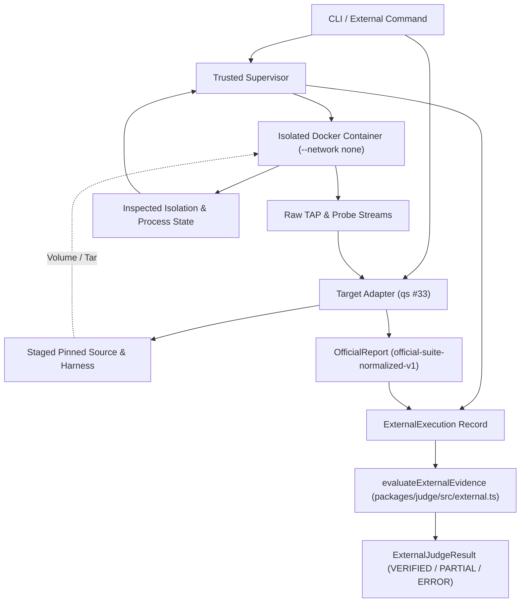

# Gate C Architecture Specification — Trusted Supervisor & External Adapter

**Role:** Architecture Agent (Agent B)  
**Date:** 2026-10-19  
**Status:** ACTIVE / SPECIFIED  
**Target:** ReplayKit Phase 2 External Runner (qs #33)  
**Protected Contracts:** `packages/contracts/src/index.ts` and `packages/judge/src/evaluate.ts` remain 100% UNTOUCHED and PROTECTED.

---

## 1. Architectural Principles & Isolation from R1

1. **No Routing Through R1**:
   - The R1 payment pipeline (`runSandbox`, PostgreSQL broker, `verifyPlan`, `payment-policy`, `apps/checkout-api`) is strictly bypassed.
   - External execution routes directly through a standalone trusted supervisor and target adapter, outputting structured evidence directly to `evaluateExternalEvidence()` in `packages/judge/src/external.ts`.
2. **Untrusted Code Never Decides Outcomes**:
   - Neither the target code nor target test output can manufacture verdicts.
   - The trusted supervisor executes outside the container, measures process status and execution duration, enforces isolation parameters, and inspects container configuration via Docker Engine API/CLI.
3. **Modular Layering**:
   - **Layer 1: Trusted Supervisor (`external-supervisor.ts`)**: Generic container orchestration, resource allocation, isolation inspection, timeout enforcement, cleanup, and evidence collection.
   - **Layer 2: Target Adapter (`qs33-adapter.ts`)**: Case-specific staging of pinned source, payload assembly, test harness execution, and normalization of raw test outputs (TAP + probe) into `OfficialReportSchema` (`official-suite-normalized-v1`).
   - **Layer 3: Evaluation Engine (`packages/judge/src/external.ts`)**: Existing approved evaluator `evaluateExternalEvidence` that checks manifest bindings, 10/3/3/1 counts, failure identity, and isolation compliance.

---

## 2. Component Architecture & Interfaces

### 2.1 Trusted Supervisor Interface

```typescript
export interface SupervisorRunOptions {
  runId: string;
  role: 'buggy' | 'reference' | 'alternate' | 'decoy';
  image: string; // Pinned image digest
  sourceDir: string; // Pinned source directory on host (read-only staged)
  payloadFiles: Array<{ path: string; bytes: number; sha256: string }>;
  command: string[]; // Container execution command
  env?: Record<string, string>;
  timeoutSeconds?: number; // Default 30s
}

export interface SupervisorExecutionResult {
  runId: string;
  role: string;
  exitCode: number | null;
  executionStatus: 'COMPLETED' | 'ERROR';
  stdout: string;
  stderr: string;
  durationMs: number;
  freshWorkspace: boolean;
  isolation: {
    networkMode: string;
    user: string;
    readonlyRoot: boolean;
    capDropAll: boolean;
    noNewPrivileges: boolean;
    cpus: number;
    memoryBytes: number;
    pidsLimit: number;
    mounts: Array<{
      type: 'tmpfs';
      destination: '/tmp' | '/run' | '/workspace' | '/testbed';
    }>;
  };
  cleaned: boolean;
}
```

### 2.2 Target Adapter Interface (qs #33)

```typescript
export interface TargetAdapter {
  readonly instanceId: string;
  readonly baseCommit: string;
  readonly image: string;
  readonly testFile: string;
  
  /** Prepare container payload and staging for a given variant role */
  preparePayload(role: 'buggy' | 'reference' | 'alternate' | 'decoy'): Promise<{
    sourceHashes: Record<string, string>;
    patchHash: string;
    testPatchHash: string;
    candidateHash: string;
    stagedDir: string;
  }>;

  /** Normalize raw container output into OfficialReportSchema */
  normalizeReport(
    stdout: string,
    stderr: string,
    exitCode: number | null,
  ): {
    reportJson: string;
    reportHash: string;
  };
}
```

### 2.3 Evidence Assembly & Evaluator Invocation

```typescript
// Assembles ExternalExecution from SupervisorExecutionResult + TargetAdapter
export function assembleExternalExecution(
  manifest: ExternalManifest,
  supervisorResult: SupervisorExecutionResult,
  adapterPayload: {
    sourceHashes: Record<string, string>;
    patchHash: string;
    testPatchHash: string;
    candidateHash: string;
  },
  normalizedReport: { reportJson: string; reportHash: string },
): ExternalExecution;
```

---

## 3. Data Flow Diagram



---

## 4. Implementation Boundaries & File Ownership

| File Path | Purpose | Owner |
| :--- | :--- | :--- |
| `docs/phase2/agents/gate-c-architecture.md` | Architecture specification & interface contracts | Architecture (Agent B) |
| `docs/phase2/agents/gate-c-security.md` | Security constraints, isolation rules, watchdog bounds | Security (Agent C) |
| `docs/phase2/agents/gate-c-evaluation.md` | Manifest configuration, test inventory, failure identity | Evaluation (Agent D) |
| `packages/runtime/src/external-supervisor.ts` | Docker lifecycle supervisor with strict isolation & watchdog | Runner / Implementation |
| `packages/runtime/src/adapters/qs33-adapter.ts` | Case adapter for qs issue 33 TAP and probe parsing | Runner / Implementation |
| `packages/cli/src/external-command.ts` | Operator CLI entrypoint for external execution | Runner / Implementation |
| `docs/phase2/agents/gate-c-qa.md` | QA review of code, test baseline, and non-regression | QA |

All changes remain strictly additive outside protected R1 paths.
