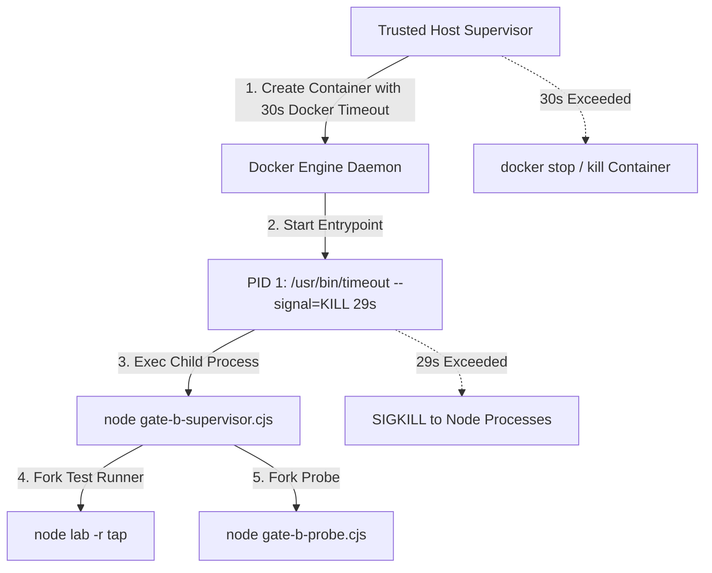

# Gate C Security & Infrastructure Specification — Container Isolation & Watchdog

**Role:** Security & Infrastructure Agent (Agent C)  
**Date:** 2026-10-19  
**Status:** ACTIVE / SPECIFIED  
**Target:** ReplayKit Phase 2 Container Execution Environment  
**Protected Assets:** Windows host security, credential isolation, R1 regression prevention.

---

## 1. Security Invariants & Boundaries

1. **Strict Container Network Isolation**:
   - Every candidate and test execution MUST run with `--network none`.
   - Preparation steps (downloading dependencies) are strictly decoupled and pre-cached; during execution, zero network calls can be initiated.
2. **Read-Only Root Filesystem**:
   - `HostConfig.ReadonlyRootfs = true`.
   - All root OS directories remain immutable during container execution.
3. **Privilege & Capability Drop**:
   - `HostConfig.CapDrop = ["ALL"]`.
   - `HostConfig.SecurityOpt = ["no-new-privileges"]`.
   - User execution fixed to nonroot UID/GID: `1000:1000`.
4. **Hard Resource Limits**:
   - CPU: `<= 1.0` (`NanoCpus = 1000000000`).
   - Memory: `<= 256 MiB` (`268435456` bytes).
   - PIDs: `<= 64` (`PidsLimit = 64`).
5. **No Host Bind Mounts**:
   - Zero host bind mounts are permitted (`HostConfig.Binds = null`).
   - Working code is staged via a private, single-tenant named volume (`volume-nocopy`) or bounded tmpfs (`/tmp`, `/run`, `/workspace`, `/testbed`).
   - Tmpfs mounts must be bounded (e.g. `/tmp` up to 32 MiB, `rw,noexec,nosuid,nodev`).

---

## 2. Process Lifecycle & Two-Tier Watchdog



### 2.1 Native Watchdog (PID 1)
- The container entrypoint is configured as:
  ```json
  ["/usr/bin/timeout", "--verbose", "--signal=KILL", "29s", "node", "/case/gate-b-supervisor.cjs"]
  ```
- This ensures an uncatchable kernel `SIGKILL` kills any hanging or runaway event loop at 29 seconds, independent of Node.js or Docker client connectivity.

### 2.2 Host-Side Watchdog (Supervisor Timeout)
- The supervisor runs Docker CLI commands with explicit process timeout (`timeoutMs: 30000`).
- If Docker CLI fails to complete, the supervisor sends `docker stop -t 2 <container-name>` followed by `docker rm -f <container-name>`.

---

## 3. Strict Resource Ownership & Guaranteed Teardown

- Container naming convention:
  `rk-ext-<runId>-<role>`
  e.g., `rk-ext-qs33-01-buggy`
- Label metadata required on every created resource:
  `replaykit.run=<runId>`
  `replaykit.role=<role>`
  `replaykit.phase=phase2`
- Cleanup invariant:
  - Cleanup is executed in `finally` blocks.
  - Before starting any new container, existing resources with the same run token are verified removed.
  - Verification checks `docker inspect` to ensure exit code, absence of OOM (`OOMKilled: false`), and complete removal of container and named volume.
  - If cleanup fails, execution status is forced to `ERROR`.

---

## 4. Verification Check Before Evaluation

Before submitting execution results to `evaluateExternalEvidence`, the supervisor inspects the container state:

| Property | Required Value | Evaluator Conformance |
| :--- | :--- | :--- |
| `networkMode` | `'none'` | `checks.offlineExecution = true` |
| `user` | `'1000:1000'` | Matches `/^(?:[1-9][0-9]*)(?::[0-9]+)?$/` |
| `readonlyRoot` | `true` | Checked against `i.readonlyRoot` |
| `capDropAll` | `true` | Checked against `i.capDropAll` |
| `noNewPrivileges` | `true` | Checked against `i.noNewPrivileges` |
| `cpus` | `<= 1` | Checked against `i.cpus <= 1` |
| `memoryBytes` | `<= 268435456` | Checked against `i.memoryBytes <= 268435456` |
| `pidsLimit` | `<= 64` | Checked against `i.pidsLimit <= 64` |
| `mounts` | Only allowed tmpfs / no host binds | Checked against `i.mounts` |
