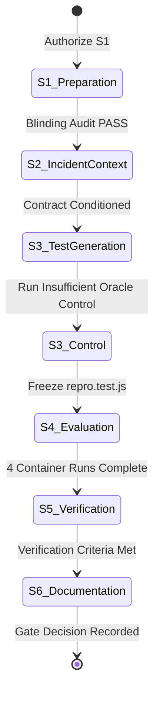

# Phase 3 Orchestration & Multi-Agent Workflow Specification

**Milestone:** Phase 3 — First Blind AI Regression-Test Generation  
**Date:** 2026-10-20  
**Status:** ACTIVE / EXECUTING  
**Target:** Authentic `ljharb/qs` Issue #33 Blind Reproduction & Test Synthesis  

---

## 1. Multi-Agent Delegation & Separation of Concerns

To guarantee that the synthesis experiment is free from evaluator bias and patch leakage, Phase 3 decomposes the workflow across 5 distinct agent roles:

```
                      +-----------------------------+
                      |   Agent A: Lead Orchestrator|
                      +--------------+--------------+
                                     |
           +-------------------------+-------------------------+
           |                         |                         |
           v                         v                         v
+--------------------+     +--------------------+     +--------------------+
| Agent B:           |     | Agent C:           |     | Agent D:           |
| Implementation     |     | Security & Sandbox |     | Evaluator          |
| - Incident Schema  |     | - Blinding Audit   |     | - Hidden Target    |
| - Generator Core   |     | - Docker Isolation |     |   Execution        |
| - Sanitizer Core   |     | - Watchdog Teardown|     | - TAP Normalization|
+--------------------+     +--------------------+     +--------------------+
                                     |
                                     v
                           +--------------------+
                           | Agent E:           |
                           | QA & Controls      |
                           | - Negative Controls|
                           | - Verification     |
                           +--------------------+
```

### Agent Responsibilities:
1. **Agent A (Lead Orchestrator)**: Defines state machine, enforces milestone boundaries, authorizes execution transitions.
2. **Agent B (Implementation)**: Authors pure schemas (`packages/contracts/src/incident-context.ts`), workspace sanitizer (`packages/runtime/src/sanitizer.ts`), and model synthesis pipeline (`packages/runtime/src/ai-generator.ts`).
3. **Agent C (Security)**: Enforces blinding invariants, audits generator filesystem for leak tokens, verifies Docker isolation (`--network none`, read-only root, nonroot UID).
4. **Agent D (Evaluator)**: Holds the hidden target configurations (Buggy, Reference Fix, Alternate Fix, Decoy Fix), dispatches isolated executions, and computes the verdict.
5. **Agent E (QA)**: Validates negative controls (Insufficient-Oracle control), verifies AST safety, checks Levenshtein novelty, and ensures zero regression of protected R1 files.

---

## 2. Six-Stage Lifecycle State Machine



### Stage Details:
- **Stage S1 (Independent Preparation)**: Construct `work/phase3/sanitized-buggy-workspace` with test #40 scrubbed from `test/parse.js`. Run automated 20-file leak audit.
- **Stage S2 (Prepare Incident Evidence)**: Model incident context according to `INCIDENT_CONTEXT_CONTRACT.md`. Bind observed errors to facts and expected behavior to behavioral specification.
- **Stage S3 (Generate a New Test)**: Call local Ollama model (`qwen2.5-coder:3b`). Extract code, validate AST, check Levenshtein distance, freeze test to `repro.test.js`.
- **Stage S4 (Hidden Evaluation)**: Mount frozen test into 4 target containers. Execute standalone and combined suite runs. Verify decoy rejection.
- **Stage S5 (Independent Evaluation & Controls)**: Verify blinding, model authenticity, 4-target differential results, and compute full artifact SHA-256 registry.
- **Stage S6 (Documentation)**: Publish decision document, agent reports, and local reproduction instructions.

---

## 3. Invariants & Negative Controls

1. **Epistemic Honesty (`INSUFFICIENT_ORACLE`)**:
   When given an incident payload without an explicit behavioral specification, the generator MUST yield `status: "INSUFFICIENT_ORACLE"` rather than hallucinating assertions.
2. **Decoy Discrimination**:
   The generated test must independently reject the subtle decoy fix (`copy = [] : {}` and `source.hasOwnProperty && ...`) with `AssertionError`. Upstream suite failure on decoy does not count.
3. **Protected R1 Immutability**:
   `packages/judge/src/evaluate.ts` and `packages/contracts/src/index.ts` must remain byte-for-byte identical (`git diff --exit-code`).
