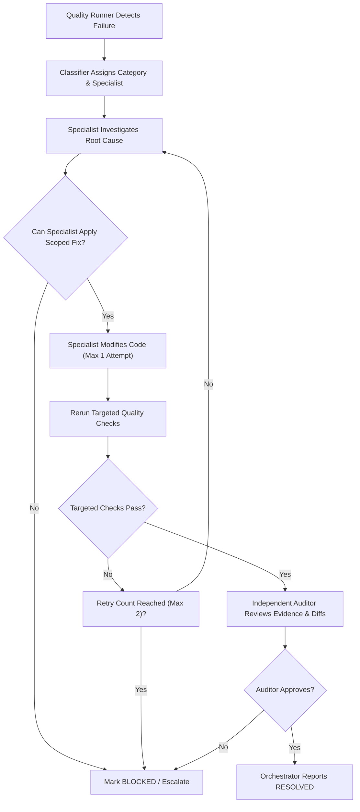

# ReplayKit — Agent Routing & Escalation Protocol

This document governs the routing of quality failures to specialized agents, the structured finding contract required from each agent, and the independent review and repair loop.

---

## 1. Specialist Agent Routing Matrix

When the Quality Runner (`scripts/quality/quality-runner.ts`) or an orchestrator check detects a failure, it is classified into one of the 11 failure categories and routed according to this matrix:

| Failure Category | Assigned Specialist | Primary Agent File | Secondary / Escalation |
|---|---|---|---|
| `TYPECHECK_FAILURE` | CLI Specialist | `.agents/agents/cli-specialist.md` | Test Auditor |
| `INVALID_GENERATED_TEST` | AI Test Specialist | `.agents/agents/ai-test-specialist.md` | Test Auditor |
| `INSUFFICIENT_ORACLE` | AI Test Specialist | `.agents/agents/ai-test-specialist.md` | Security Auditor |
| `APPLICATION_REGRESSION` | Test Auditor | `.agents/agents/test-auditor.md` | CLI Specialist |
| `FRAMEWORK_INCOMPATIBILITY` | AI Test Specialist | `.agents/agents/ai-test-specialist.md` | Docker Specialist |
| `DEPENDENCY_FAILURE` | Docker Specialist | `.agents/agents/docker-specialist.md` | CLI Specialist |
| `DOCKER_TIMEOUT` | Docker Specialist | `.agents/agents/docker-specialist.md` | CLI Specialist |
| `SANDBOX_VIOLATION` | Security Auditor | `.agents/agents/security-auditor.md` | Lead Orchestrator |
| `EVIDENCE_INTEGRITY_FAILURE` | Security Auditor | `.agents/agents/security-auditor.md` | Test Auditor |
| `EVALUATOR_FALSE_POSITIVE` | Test Auditor | `.agents/agents/test-auditor.md` | Security Auditor |
| `PERFORMANCE_REGRESSION` | CLI Specialist | `.agents/agents/cli-specialist.md` | Docker Specialist |

---

## 2. Structured Finding Schema

Every specialized agent must return its diagnosis and remediation findings to the orchestrator in the following standardized structured format (available as TypeScript interface and JSON artifact):

```typescript
export interface AgentFinding {
  agentRole: "test-auditor" | "ai-test-specialist" | "docker-specialist" | "cli-specialist" | "security-auditor";
  incidentId: string;
  timestamp: string;
  failureCategory: FailureCategory;
  diagnosis: {
    symptom: string;
    rootCause: string;
    triggeringFileOrCommand: string;
    observedLogsOrDiff: string;
  };
  remediation: {
    actionTaken: "SCOPED_FIX" | "CONFIG_ADJUSTMENT" | "BLOCKED" | "ABSTAIN";
    changedFiles: string[];
    justification: string;
  };
  verification: {
    testsExecuted: string[];
    exitCodes: Record<string, number>;
    evidenceArtifacts: string[];
  };
  residualRisks: string[];
  status: "RESOLVED" | "UNRESOLVED" | "BLOCKED";
}
```

### Finding JSON Format Example
```json
{
  "agentRole": "docker-specialist",
  "incidentId": "inc-20261021-001",
  "timestamp": "2026-10-21T04:30:00Z",
  "failureCategory": "DOCKER_TIMEOUT",
  "diagnosis": {
    "symptom": "Docker ps enumeration timed out after 5000ms",
    "rootCause": "Child process spawned via shell string was waiting for interactive EOF on Windows",
    "triggeringFileOrCommand": "packages/runtime/src/docker-cleanup.ts",
    "observedLogsOrDiff": "Docker command timed out: ps"
  },
  "remediation": {
    "actionTaken": "SCOPED_FIX",
    "changedFiles": ["packages/runtime/src/docker-cleanup.ts"],
    "justification": "Switched from exec to execFile with argument array and 10000ms bounded timeout"
  },
  "verification": {
    "testsExecuted": ["pnpm vitest run packages/runtime/src/docker-cleanup.test.ts"],
    "exitCodes": { "packages/runtime/src/docker-cleanup.test.ts": 0 },
    "evidenceArtifacts": ["work/quality-runs/run-20261021-001/evidence.log"]
  },
  "residualRisks": ["Heavily overloaded Windows hosts may occasionally require up to 8s for daemon response"],
  "status": "RESOLVED"
}
```

---

## 3. Independent Review and Repair Loop



### Loop Rules
1. **Max Retries**: The automated repair loop is strictly capped at **2 iterations**. If the issue is not resolved within 2 iterations, the status transitions to `BLOCKED` and the orchestrator must halt and request human operator guidance.
2. **Zero Self-Approval**: No agent may approve its own code modifications. An independent `Test Auditor` or `Security Auditor` must inspect the git diff and execution evidence before any task is marked complete.
3. **Protected Files Invariant**: If any proposed remediation attempts to modify `packages/judge/src/evaluate.ts` or `packages/contracts/src/index.ts`, the `Security Auditor` immediately triggers a hard abort.
4. **No Test Weakening**: Never weaken an assertion or suppress a TypeScript diagnostic simply to make a check pass.
